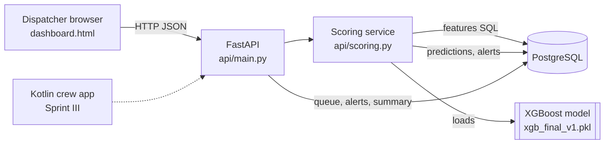
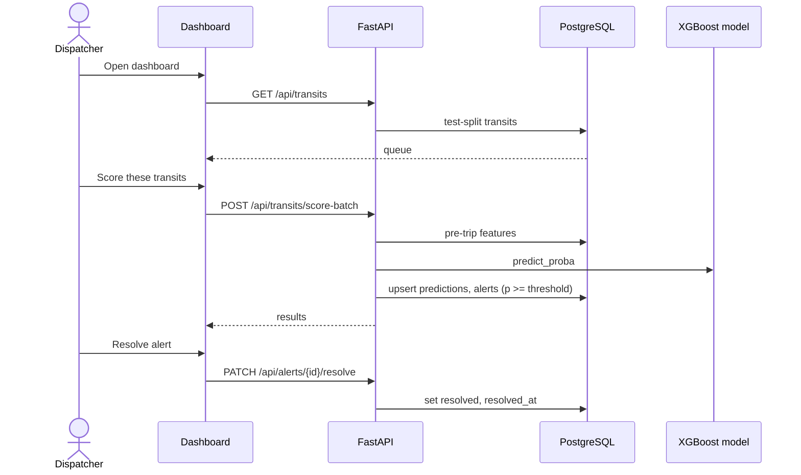
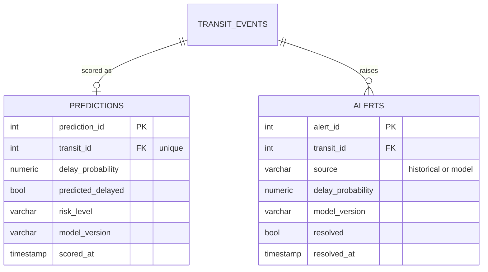
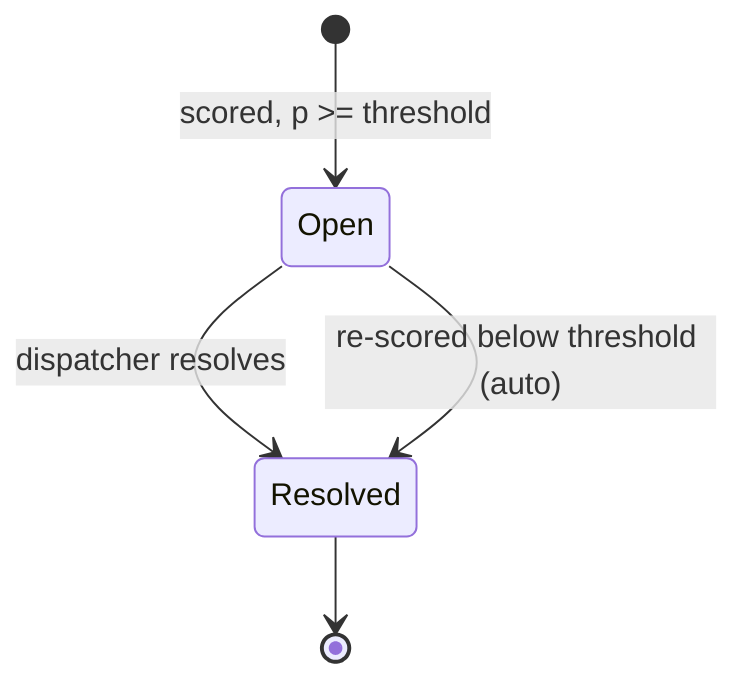

# Chapter 4 diagram updates (design changes in Sprint II)

What changed from the Sprint I design:
- A **predictions** table stores every score (one row per transit, replaced on re-score).
- The **alerts** table gains `delay_probability`, `source` (historical or model), `model_version` and `resolved_at`. A partial unique index allows one model alert per transit.
- Alerts are produced by the model through the API, not only loaded from history.
- A **web dispatcher dashboard** is the first interface; the Kotlin app follows in Sprint III.

## System architecture

## Core workflow (sequence)

## Data model additions

## Alert lifecycle

A resolved alert is not reopened by a re-score at or above the threshold; the dispatcher's decision stands.
